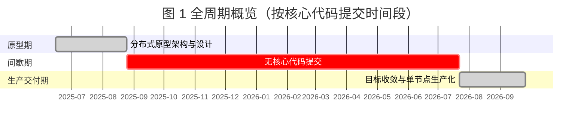
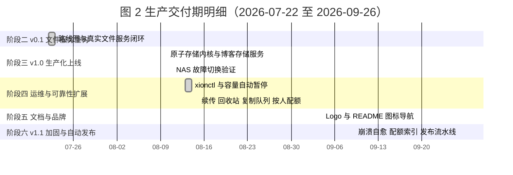
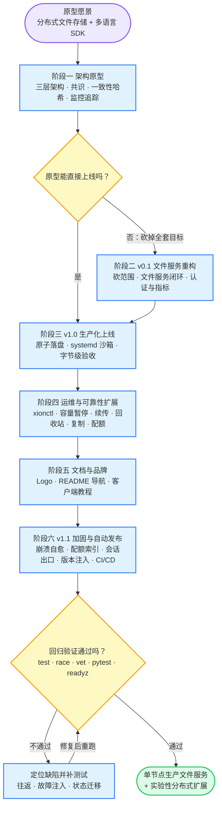

# 分布式文件存储系统开发大纲 · 星辰离子X（AstraStoreXion）

> **本文档的组织原则**：阶段与版本按**核心代码的提交时间段**划分，时间轴直接取自仓库提交记录（`git log --date=short`）。每个阶段都能回溯到具体提交，只讲清"这个版本解决了什么问题、落地了哪些核心能力"，不再展示实现代码。
>
> **一句话主线**：目标从"分布式存储全套原型"收敛为**一台能上线的单节点持久化文件服务**；Raft、元数据服务、存储节点、gRPC 多语言客户端保留为实验性扩展，不属于当前生产依赖。

## 一、项目目标

- **提高网站资源加载速度**：收敛存储链路，减少一次文件访问经过的组件数，把"能不能取到"变成"能不能快速取到"。
- **支持水平扩展（长期目标）**：保留一致性哈希、分片与副本的设计与接口，扩容前必须先解决副本一致性与迁移策略。
- **保证高可用性和数据一致性**：现阶段以"写入原子性 + 可自证元数据 + 全量启动自检 + 主机级备份"守住一致性底线，单节点不承诺自动故障转移。
- **实现低延迟读写**：数据面只做必要的落盘与校验，读路径不做多余扫描；容量与配额统计走内存索引，代价不随对象数增长。

## 二、开发甘特图

甘特图分成"全周期概览"和"交付期明细"两张：2026 年的阶段普遍只有 1–3 天，放在 15 个月的横轴上会被压成一条线，因此在概览之后按交付期放大展示。

**读图说明**

| 时间轴 | 提交区间 | 版本产出 |
| --- | --- | --- |
| 2025-06-15 → 2025-08-25 | `6f60d41` → `bd3742d` | 分布式原型：三层架构、共识、分片、多语言 SDK |
| 2025-08-25 → 2026-07-22 | 仅 `4221518` 一次 README 修订 | 间歇期：无核心代码提交 |
| 2026-07-22 → 2026-07-23 | `35d4798` → `6ecd254` | v0.1：真实文件服务闭环 |
| 2026-08-10 → 2026-08-11 | `8ad7536` → `7561ad0` | v1.0：生产可用的博客存储服务 + 故障切换验证 |
| 2026-08-13 → 2026-08-15 | `8a44f0d` → `f6aa381` | 运维与可靠性扩展：六个独立能力 |
| 2026-09-04 | `bdeb00d` → `fd3eccb` | 文档与品牌 |
| 2026-09-26 | `a0dad6f` → `cf54285` | v1.1：生产加固与自动发布 |

## 三、开发流程图

流程按"目标收敛 — 生产化 — 故障面扩展 — 加固回归"重画，只保留主线、两个关键判断和一条回归回路。

## 四、版本演进（按核心代码提交时间段）

### 阶段一｜架构原型期（2025-06-15 → 2025-08-25）

**锚点提交**：`6f60d41` ＋ `1ee1c61`（2025-06-15 开发大纲成文）→ `66db7e1`（2025-06-22 系统架构，21 个文件，+1238）→ `c0d40d9`（2025-07-12 完善客户端SDK，51 个文件，+5039）→ `4a401b5`（2025-07-16 监控模块、分布式追踪、网关认证与授权，17 个文件，+2077）→ `bd3742d`（2025-08-25 更新开发指南）。

**版本目标**：先搭出"什么都能有"的分布式存储全栈，验证架构可行性。

**核心功能**

1. **三层架构骨架**：接入层（API 网关）／元数据层（MySQL 元数据服务）／存储层（存储节点）三个独立进程与三份配置，配 Dockerfile、Docker Compose 和 MySQL 初始化脚本一次成型，具备"一条命令起全套"的演示能力。
2. **服务契约先行**：用 Protocol Buffers 定义文件服务接口，网关、元数据、存储节点共享同一套消息定义，接口先于实现固化。
3. **数据分布**：一致性哈希环 + 虚拟节点，按文件 ID 选择存储节点，支撑节点增删后的数据再分布。
4. **共识与副本**：基于 Hashicorp Raft 封装节点、日志复制与领导者选举，为副本一致性预留实现位。
5. **本地存储引擎**：分块写入／读取的初版实现，建立"文件 = 多个块 + 块位置元数据"的模型。
6. **多语言客户端 SDK**：Go、Java、NodeJS、Python 四套客户端同时落地，覆盖上传、状态查询、删除等接口。
7. **可观测与安全**：监控指标、通知与 Prometheus 接入、分布式追踪模块，以及网关侧的认证与授权。
8. **工程化**：Makefile 统一构建、本地开发启停脚本、容器编排与配置模板。

**阶段结论与遗留问题**

- 交付的是**完整原型而非可用服务**：没有真实文件读写闭环，网关只做路由，数据不真正落盘。
- 组件与依赖过重（MySQL、Consul、Etcd、Prometheus、Grafana、Raft 同时在线），与目标服务器约 1.9 GiB 内存的现实严重不符。
- 该阶段多数模块在后来的生产形态中被降级为实验性扩展，只保留接口与骨架。

### 阶段二｜v0.1 文件服务重构（2026-07-22 → 2026-07-23）

**锚点提交**：`35d4798` ＋ `bcacea3`（2026-07-22 文件服务现代化路线图与 v0.1 交付计划）→ `3d7ed0c`（07-23 修复监控指标测试失败）→ `562f02a`（07-23 优化核心认证和监控指标）→ `6ecd254`（07-23 添加真实文件服务闭环，10 个文件，+823）。

**版本目标**：承认原型无法上线，重新界定 v0.1 范围——文件 API、元数据模型、安全与运维、易部署——先把**一次真实文件生命周期**跑通。

**核心功能**

1. **范围收敛成文**：以设计文档与交付计划明确"v0.1 做什么、明确不做什么"，把分布式组件从交付路径中摘出。
2. **独立文件服务层**：新增文件服务的模型与业务层，文件对象、状态、校验和、大小等概念从元数据服务中解耦出来。
3. **真实文件服务闭环**：API 网关打通上传、状态查询、下载、删除的完整链路，文件字节第一次真正被写入本地磁盘并可读回。
4. **元数据服务与本地存储对接**：元数据记录与磁盘对象建立可核对的对应关系，替换掉原型期的空转调用。
5. **认证与监控指标收敛**：修复监控指标测试失败，把网关认证与指标采集调整到新链路上，为后续"服务端密钥 + 结构化错误"打底。

**阶段结论**：项目第一次拥有"能存能取"的最小可验证服务；也为下一步的原子性、安全边界和生产部署腾出了干净的落点。

### 阶段三｜v1.0 生产化上线（2026-08-10 → 2026-08-11）

**锚点提交**：`8ad7536`（2026-08-10 生产可用的博客存储服务，34 个文件，+3451/−2087）→ `9f65da3` ＋ `51a960a`（08-11 定义并规划 NAS 故障切换测试）→ `7561ad0`（08-11 记录测试结果）。

**版本目标**：让文件服务真正承接博客流量：不丢文件、能查能删、重启后还在，并且能在最小权限下长期运行。

**核心功能**

1. **原子存储内核**：对象字节与 JSON manifest 分离落盘；上传走"临时文件 → 落盘同步 → 原子改名 → 目录同步"，先提交对象再提交元数据，任一步失败显式回滚，磁盘上不会出现半个文件或孤儿对象。
2. **可自证元数据**：manifest 内的 ID 必须与文件名一致，读元数据时校验 ID、状态、大小与校验和，把"被改名／覆盖／截断"从静默错误变成启动即发现的显式错误。
3. **路径安全**：对象 ID 必须是服务端生成的 UUID（正则白名单），用户提供的原始文件名只作为元数据保存，不参与任何路径拼接，从结构上消除路径穿越。
4. **完整文件生命周期**：上传、列表、状态、下载、幂等删除，配套 1 GiB 默认上限与结构化错误响应。
5. **服务端认证**：常量时间比较 Bearer 服务密钥；服务只监听回环地址，链路为"浏览器 → Django（JWT + 业务元数据）→ AstraStoreXion（服务密钥）"。
6. **Python SDK 1.1**：流式下载、安全重试、结构化异常，替换早期演示级客户端。
7. **最小权限部署**：systemd 沙箱（只读系统盘 + 单一可写数据目录、清空 capability、禁可执行内存）与非敏感环境模板，配套字节级 smoke test 脚本。
8. **可复现测试资料**：脚本生成 PNG、PDF、DOCX、TXT 与校验和清单，供本地与生产上传／下载验收复用。
9. **NAS 故障切换验证**：停止服务器侧 Xion 进程后，NAS 上的副本就绪检查返回 200，已有文件通过博客公开地址仍可读。

**阶段结论与边界**

- 单节点生产形态成立：重启后仍可查询与下载，删除幂等，存储的是"字节真的一模一样"。
- 故障切换只证明了**计划内的手动切换**：FRP 中继与主服务同机，整机宕机时 NAS 无法经同一通道被访问；生产化前还需要独立中继、持续复制队列、删除同步与自动切换策略。

### 阶段四｜运维与可靠性扩展（2026-08-13 → 2026-08-15）

**锚点提交**：`8a44f0d`（08-13 xionctl 服务器文件操作，9 个文件 +762）→ `bfe1116`（08-13 xionctl 服务日志）→ `608210f`（08-13 容量感知的存储自动暂停，16 个文件 +349）→ `018efe4`／`bba6e9a`／`7a1a0e3`（08-13 容量输出终端化）→ `a230690`（08-14 上传上限可配置）→ `7da0296`（08-14 默认上限提到 1 GiB）→ `383326a`／`43a9a1c`（08-15 可恢复分片上传）→ `5b98bfd`／`96ee538`（08-15 回收站与恢复接口）→ `18d0944`／`90864c6`（08-15 持久化复制队列）→ `b751e74`／`8edb24d`（08-15 按 owner 配额与查询接口）。

**版本目标**：服务能跑之后，把"长期运行会遇到的事"补齐——运维要能操作、磁盘写满要能保护、大文件要能续传、误删要能恢复、数据要能复制、租户要能限额。

**核心功能**

1. **`xionctl` 服务器命令行**：健康检查、容量、配置、列表、详情、上传、下载、安全删除，加上按行数／时间／跟随模式查看 systemd 运行日志。它只通过服务 API 工作，绝不直接动数据目录，删除必须显式 `--yes`，服务令牌只从受限环境文件读取。
2. **容量自动暂停**：基于文件系统真实用量（`statfs`）而非估算，达到阈值（生产默认 90%）只暂停写入，上传返回 HTTP 507；读取、下载、删除不受影响，释放空间后下一次上传自动恢复，无需重启。`xionctl capacity` 用终端表格展示总量、已用、可用、使用率与上传状态。
3. **上传上限可运维**：单文件上限从写死改为可配置（默认 1 GiB），`xionctl config` 查看，修改时自动备份环境文件、原子替换并重启服务。
4. **可恢复分片上传**：一个会话一个追加写文件，已收字节数即文件大小；客户端必须声明偏移，`Content-Length`、`Content-Range` 与总大小必须自洽；任一环节失败都截断回初始长度，因此失败上传可以无脑重试。全部字节到位后重算整体 SHA-256 并与声明值比对才转正。
5. **回收站与恢复**：删除不是真删，而是把对象与 manifest 一起移入回收站目录；恢复后文件 ID 不变，已发出去的下载链接继续有效。设计上刻意不提供"无参数永久删除"。
6. **持久化异步复制队列**：默认关闭；开启后上传、软删除、恢复都会写入持久化任务，由后台 worker 流式推送。副节点收到的请求带复制标记，不会再次入队形成循环；推送前先比对大小与校验和，因此重试天然幂等；复制对象沿用源 ID，切换后链接无需改写。
7. **按 owner 配额**：以元数据中的 owner 为配额键，统计范围包含活动文件、回收站文件，以及**按声明完整大小**计入的未完成分片会话（防止"声明 1 GiB 却永不续传"白占额度）；超额返回 HTTP 507。它与文件系统阈值构成两层独立保护：一层管人，一层管盘。

**阶段结论**：单节点服务从"能用"变成"能运维、能自保"；六个能力彼此独立，任一关闭都不影响其余功能。

### 阶段五｜文档与品牌（2026-09-04）

**锚点提交**：`bdeb00d`／`d5447c7`／`99529f8`／`02fa5a0`（Logo 资产与 README 展示）→ `de68302`／`4e24f44`／`fd3eccb`（README 图标导航）。

**核心功能**：补齐项目对外门面——AstraStoreXion 标识资产、README 顶部品牌展示与区块导航，让"当前能力、快速开始、限制"这些结论类信息更容易被读到；客户端使用教程与运维手册在同一时期与代码行为对齐。

### 阶段六｜v1.1 生产加固与自动发布（2026-09-26）

**锚点提交**：`a0dad6f`（存储崩溃残留可恢复、配额计量精确）→ `9264dcc`（回收站清理、上传会话管理与真实列表总数）→ `a47b48b`（版本元数据注入与推送式自动发布）→ `2a20e35`（复制失败改为退避，不再打热循环）→ `b3bab74`（配额按 owner 计数修正）→ `5dde4c7`（复制关闭时上传 panic 修复）→ `f9a75f2`（运维文档与 Python SDK 补续传能力）→ `115e31b`／`ec2f523`（发布流水线与暂停阈值语义）→ `77856cf`（CI 补 pytest）→ `dceb5a5`／`41be7c2`（备份含对象数据、异地告警）→ `5bbe173`／`cf54285`（记录部署漂移方向与预览故障）。

**版本目标**：不动功能边界，只让已有能力在真实故障下站得住——这轮问题几乎都不是新代码，而是原有实现。

**核心功能**

1. **启动自愈**：服务在接受流量前先做一次修复，把崩溃残留的临时文件移入隔离区（移入而非删除，证据可查），直接消灭"进程在写 manifest 与改名之间被杀、就绪检查永久报错、只能人工登服务器删文件"的可用性缺陷；同时用守门测试确保真正的损坏（如无 manifest 的孤儿对象）仍然报错，不被自愈掩盖。
2. **配额统计改为增量索引**：从"每次上传全量扫描并解析所有 manifest"改为启动重建、之后增量维护的三类目索引（活动文件／回收站／未完成会话）。分桶的意义是让状态迁移精确——上传完成、删除、恢复、彻底清理、会话中止各自只做一次迁移，字节要么在一个桶里要么不在，结构上不会重复计费或凭空消失；容量与对象计数也从索引直读，代价不再随对象数增长。
3. **回收站与分片会话给出出口**：会话按 TTL 自动过期（模板默认 24 小时），并在下一次上传前清理，客户端无需等待后台任务即可拿回额度；回收站提供 `xionctl trash purge`，必须同时给出保留期或清空意图并显式确认。
4. **接口语义修正**：列表接口新增真实总数（此前 `count` 只是当前页条数）；时间读取统一收口到可注入时钟，使 TTL 与保留期行为可测。
5. **复制重试退避**：失败任务记录下次可执行时间并指数退避，不再在几秒内烧光重试次数；同时修掉"先唤醒 worker 后写任务"的窗口，手动重试仍立即生效。
6. **元数据克隆缺陷修复**：分片会话在复制元数据时因求值顺序问题丢空，导致 owner 在整条分片上传链路上丢失、按人配额从未真正生效；修复后补充往返测试，断言元数据经过一轮写入读取后仍然完整。
7. **版本可查与交叉编译**：构建时注入版本与提交号，`xionctl version` 直接显示线上构建；一条命令产出 Linux 静态二进制。
8. **CI 与发布流水线**：CI 执行格式检查、`go vet`、单元与竞态测试、发布构建与 Python SDK 测试；推送到主分支触发自动发布——构建并测试、打包上传、SSH 原子安装、重启后轮询就绪检查，失败自动回滚到上一版二进制。容器镜像形态同步对齐生产服务，原分布式镜像明确标记为实验目标。
9. **备份与异地告警**：备份在打包前停止服务，用校验和与试读确认归档可恢复，并对"备份从未离开本机"发出告警；同时持续记录部署漂移（博客主分支不是生产真相源）与预览故障，避免"代码看起来上线了、线上其实没变"。

**阶段结论**：v1.1 没有新增业务能力，但把可靠性从"正常路径返回 200"推进到"故障路径仍能启动、仍能算对、仍能回退"。

## 五、测试与验证流程

| 层次 | 内容 | 覆盖的问题 |
| --- | --- | --- |
| 日常回归 | `go test ./... -count=1`、`go test ./... -race`、`go vet ./...`、Python SDK 的 pytest | 逻辑正确性与数据竞争 |
| 持续集成 | 格式检查、vet、测试、竞态测试、发布构建、SDK 测试，随每次推送与合并请求执行 | "只靠本地手跑"漏掉的问题 |
| 就绪自检 | 就绪接口对全部存储目录做一致性校验：元数据合法且对应对象存在、无孤儿对象、会话与分片文件状态一致、回收站条目成对、临时目录为空、隔离区只允许白名单内容 | 一致性损坏，且不把真问题藏进自愈 |
| 字节级验收 | smoke test：上传 → 下载 → 比对 SHA-256 → 退出前清理；四种格式样本（PNG／PDF／DOCX／TXT）逐一执行 | "返回 200 但字节不对" |
| 故障切换 | 停主节点进程，验证副本可读与就绪状态 | 计划内手动切换；结论是整机宕机仍不可接管 |
| 恢复演练 | 解包备份 → 起临时实例跑就绪自检 → 逐个比对 manifest 校验和与实际字节 → 再上生产，且先保留旧目录 | 备份"能不能真的恢复" |
| 上线验收 | 四种样本上传下载、数据库后端标记为对象存储、重启后仍可下载、删除后对象同步消失、抽查历史媒体链接 | 融合上线后的端到端行为 |

**测试策略的三条经验**（v1.1 的实际收获）：返回值正确不等于状态正确，于是补齐了三类测试——**往返测试**（写完再读，断言字段没有被中途丢掉）、**故障注入测试**（在自己定义的崩溃点留残留物，断言服务仍能启动）、**状态迁移测试**（对同一对象依次执行上传→完成→删除→恢复→清理，每一步断言总量）。

## 六、关键风险与应对

| 风险 | 应对 | 状态 |
| --- | --- | --- |
| 脑裂 | 保留 Pre-Vote 与法定节点数（N/2+1）设计 | 原型栈设计，生产单节点形态下不启用 |
| 崩溃残留导致服务起不来 | 启动自愈 + 隔离区白名单 + "真损坏仍报错"守门测试 | 已落地 |
| 配额被绕过 | 三类目索引，未完成会话按声明完整大小预扣 | 已落地 |
| 磁盘写满 | 按文件系统真实用量在阈值处只停写，读与删继续 | 已落地 |
| 回收站只增不减 | 会话 TTL 自动过期 + 带保留期与显式确认的清理命令 | 已落地 |
| 复制积压与热循环 | 持久化任务队列 + 指数退避 + 按内容判断的幂等重试 | 已落地（异步，不回滚主节点写入） |
| 部署漂移 | 版本注入 + 自动发布与失败回滚 + 记录"主分支不是生产真相源" | 已落地 |
| 备份与数据同盘 | 备份脚本 + "未离开本机"告警，要求异地同步 | 部分依赖人工执行异地同步 |
| 热点文件 | 客户端本地缓存、并行分块下载、热点迁移 | 仍为原型／设计阶段，未进入生产路径 |

## 七、当前状态与边界

**已具备（生产）**：单节点持久化文件服务——原子上传与重启持久化、完整文件生命周期、服务端密钥认证、容量自动暂停与按 owner 配额两层保护、可恢复分片上传、回收站与恢复、可选主从异步复制、版本可查的自动发布流水线、主机级备份与恢复演练流程。

**实验性扩展（非生产依赖）**：Raft 共识与副本、元数据服务、存储节点、一致性哈希与热点检测、gRPC 接口与 Go／Java／NodeJS 客户端；这些模块保留设计价值，扩容前必须先完成副本一致性与迁移策略。

**明确限制**：当前数据面为单节点，没有副本、自动故障转移和跨区域容灾；配额与容量统计依赖内存索引，绕过服务直接改动数据目录后需要重启重建；复制是异步的，切换前必须评估待处理任务；历史媒体不迁移；磁盘级可靠性依赖主机备份，而默认备份与数据同盘，异地同步尚未内置。**先把边界说清楚，再谈能力**——这是项目从原型走到可上线，最实际的一课。
